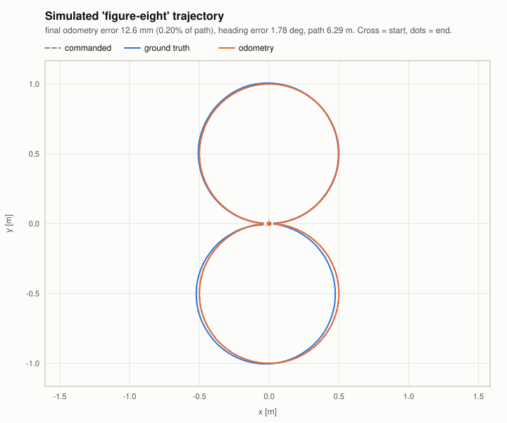

# mecanum-kinematics

[](https://github.com/projectbin07-stack/mecanum-kinematics/actions/workflows/ci.yml)
[](LICENSE)

Kinematics, encoder odometry and a deterministic simulator for 4-wheel mecanum
drive robots, as a small Python library and CLI that works with or without
ROS 2 and needs no hardware to test.

> **Validation status:** everything here is verified by unit tests and
> simulation only. It has **not** been run on a physical robot, and the ROS 2
> example has not been executed. See [Known limitations](#known-limitations).

## Why it exists

Mecanum math is short, but it is easy to get a sign wrong, and the mistake
usually shows up as a robot driving into a table leg. Most implementations are
buried inside a ROS package or firmware, where they can only be tested with
the robot switched on. This project keeps the math in plain Python with numpy
as the only dependency, writes down the sign conventions and the derivation
([docs/kinematics.md](docs/kinematics.md)), and checks each formula against
hand-computed values, so the same code can be unit-tested on a laptop and then
called from a ROS 2 node, a script or a notebook.

## Features

- **Robot config** from TOML or a dict: wheel radius, half-length `lx`,
  half-width `ly`, roller angle, encoder counts per rev, gear ratio, wheel
  order, max wheel speed. Three illustrative example configs are bundled.
- **Inverse kinematics**: body twist `(vx, vy, wz)` to four wheel speeds.
- **Forward kinematics** by least squares, with a **slip residual** that
  measures how inconsistent the four wheel speeds are with rigid motion.
- **Saturation** that scales all wheels uniformly, so a too-fast command
  slows the robot down without bending its path.
- **Odometry** from encoder tick deltas with exact arc integration on SE(2)
  and a simple, documented covariance growth model.
- **Simulator**: fixed time step, first-order motor lag, optional encoder
  quantisation, seeded Gaussian wheel slip. Trajectories: line, strafe,
  square, circle, figure-eight, spin. Reports ground truth versus odometry.
- **CLI**: `mecanum ik`, `fk`, `simulate`, `odom`, `configs`.
- **SVG plots without matplotlib** (pure-Python writer); matplotlib is an
  optional extra for PNG/PDF output.
- **ROS 2 example** node (`cmd_vel` in, wheel speeds and `odom` out) under
  [examples/ros2](examples/ros2), not executed in CI.
- Typed (`py.typed`, mypy strict), Python 3.10+.

## Install

Not published on PyPI. Install from GitHub:

```bash
pip install "git+https://github.com/projectbin07-stack/mecanum-kinematics.git@v0.1.0"

# with the optional matplotlib plots
pip install "mecanum-kinematics[plot] @ git+https://github.com/projectbin07-stack/mecanum-kinematics.git@v0.1.0"
```

Or from a clone, for development:

```bash
git clone https://github.com/projectbin07-stack/mecanum-kinematics.git
cd mecanum-kinematics
pip install -e ".[dev]"
```

Runtime dependencies: `numpy`, plus the `tomli` backport on Python 3.10 only
(Python 3.11+ reads TOML with the standard library).

## Quick start

### Command line

The examples use the bundled `generic-small` config (r = 0.03 m, lx = 0.08 m,
ly = 0.09 m, 30 rad/s wheel limit). All output below is copied from real runs.

```console
$ mecanum ik --vx 0.5 --vy 0.2 --wz 1.0
config: generic-small
twist:  vx=0.5000 m/s  vy=0.2000 m/s  wz=1.0000 rad/s
wheel   rad/s        rpm
FL       4.3333      41.38
FR      29.0000     276.93
RL      17.6667     168.70
RR      15.6667     149.61

$ mecanum ik --vx 2.0
config: generic-small
twist:  vx=2.0000 m/s  vy=0.0000 m/s  wz=0.0000 rad/s
wheel   rad/s        rpm
FL      30.0000     286.48
FR      30.0000     286.48
RL      30.0000     286.48
RR      30.0000     286.48
saturated: all wheels scaled by 0.4500 to respect max_wheel_speed=30 rad/s
achieved: vx=0.9000 m/s  vy=0.0000 m/s  wz=0.0000 rad/s

$ mecanum fk -- 10 12 10 10
config: generic-small
twist:  vx=0.3150 m/s  vy=0.0150 m/s  wz=0.0882 rad/s
slip:   rms residual 0.5000 rad/s, ratio 0.0475
```

Simulate a figure-eight with wheel slip and quantised encoders, and plot it:

```console
$ mecanum simulate --trajectory figure-eight --slip-noise 0.02 --seed 3 --quantise --plot figure-eight.svg
config:      generic-small
trajectory:  figure-eight, 21.44 s, 2145 steps of 0.01 s
model:       tau=0.05 s, slip_noise=0.02, seed=3, quantised=yes
ground truth final: x=-0.0107 m  y=-0.0072 m  theta=-0.0310 rad
odometry final:     x=-0.0002 m  y=-0.0005 m  theta=+0.0000 rad
path length:        6.2864 m
odometry error:     final 12.55 mm (0.200% of path)
                    max 32.86 mm, rms 18.84 mm, heading +1.779 deg
tracking error:     12.93 mm from the commanded end point
odometry 1-sigma:   x 15.64 mm, y 9.03 mm, theta 1.463 deg
wrote plot: figure-eight.svg
```



The plot is from a simulation with made-up slip, not from a robot. The
commanded path is hidden under the odometry trace because slip moves the real
robot, not the encoders.

A noise-free square is the basic sanity check: the robot must come back to
where it started.

```console
$ mecanum simulate --trajectory square --plot out.svg
config:      generic-small
trajectory:  square, 13.83 s, 1384 steps of 0.01 s
model:       tau=0.05 s, slip_noise=0, seed=0, quantised=no
ground truth final: x=+0.0000 m  y=+0.0000 m  theta=+0.0000 rad
odometry final:     x=+0.0000 m  y=+0.0000 m  theta=+0.0000 rad
path length:        3.9751 m
odometry error:     final 0.00 mm (0.000% of path)
                    max 0.00 mm, rms 0.00 mm, heading +0.000 deg
tracking error:     0.00 mm from the commanded end point
wrote plot: out.svg
```

(The path is 3.975 m rather than 4 m because the motor lag rounds the
corners.)

Integrate a log of encoder counts. The CSV needs a header naming the columns
`fl`, `fr`, `rl`, `rr` in any order; a `t` column is optional. Rows are
increments by default, or running totals with `--cumulative`.

```console
$ mecanum odom tests/data/ticks_delta.csv
config:   generic-small
rows:     15 (increments)
pose:     x=+0.1885 m  y=+0.0942 m  theta=+0.0000 rad
distance: 0.2827 m
```

Every command takes `--config NAME_OR_PATH` and `--json`.

```console
$ mecanum --help
usage: mecanum [-h] [--version] COMMAND ...

Kinematics, odometry and simulation for 4-wheel mecanum drive robots. Body frame: x forward, y
left, yaw counter-clockwise (ROS REP-103).

positional arguments:
  COMMAND
    ik        body twist -> wheel speeds
    fk        wheel speeds -> body twist
    simulate  run a simulated trajectory and report odometry drift
    odom      integrate an encoder tick CSV into a pose
    configs   list the bundled illustrative configs

options:
  -h, --help  show this help message and exit
  --version   show program's version number and exit
```

```console
$ mecanum simulate --help
usage: mecanum simulate [-h] [-c NAME_OR_PATH] [--json]
                        [-t {circle,figure-eight,line,spin,square,strafe}] [--size SIZE]
                        [--speed SPEED] [--dt DT] [--tau TAU] [--slip-noise SLIP_NOISE]
                        [--seed SEED] [--quantise] [--plot FILE] [--csv FILE]

Deterministic simulation: motor lag, optional encoder quantisation and seeded wheel slip. Reports
ground truth versus odometry.

options:
  -h, --help            show this help message and exit
  -c, --config NAME_OR_PATH
                        TOML robot config, or the name of a bundled illustrative example (default:
                        generic-small; see 'mecanum configs')
  --json                print machine-readable JSON
  -t, --trajectory {circle,figure-eight,line,spin,square,strafe}
                        path to drive
  --size SIZE           distance, side or radius [m]; number of turns for 'spin' (default depends
                        on path)
  --speed SPEED         speed [m/s]; yaw rate [rad/s] for 'spin'
  --dt DT               time step [s] (default: 0.01)
  --tau TAU             motor time constant [s] (default: 0.05)
  --slip-noise SLIP_NOISE
                        wheel slip intensity [rad^0.5]; 0 disables slip (default: 0)
  --seed SEED           random seed for slip (default: 0)
  --quantise            quantise encoders to whole counts
  --plot FILE           write a path plot; .svg needs no extra packages, other types need
                        matplotlib
  --csv FILE            write the time histories of all poses as CSV
```

(Help text captured on Python 3.14; older Python versions lay out the option
lines slightly differently.)

### Python

```python
from mecanum_kinematics import (
    MecanumKinematics,
    MecanumOdometry,
    SimulationOptions,
    Twist,
    load_example,
    simulate,
    square,
)

robot = load_example("generic-small")  # or RobotConfig.from_toml("my_robot.toml")
model = MecanumKinematics(robot)

command = model.inverse_saturated(Twist(vx=0.5, vy=0.2, wz=1.0))
print(command.speeds.round(3), command.saturated)
# [ 4.333 29.    17.667 15.667] False

print(model.forward([10.0, 12.0, 10.0, 10.0]).slip_ratio)
# 0.04745789978762495

odom = MecanumOdometry(robot, slip_noise=0.02)
for _ in range(10):
    odom.update_ticks([132, 132, 132, 132])  # encoder count deltas, in wheel_order
print(odom.pose)
# Pose2D(x=0.18849555921538755, y=-4.777397638706851e-17, theta=-1.3877787807814457e-16)

result = simulate(robot, square(side=1.0, speed=0.3), SimulationOptions(slip_noise=0.02, seed=1))
print(f"{result.drift.final_position_error * 1000:.1f} mm after {result.drift.path_length:.2f} m")
# 10.6 mm after 3.98 m
```

### Describing your robot

```toml
# my_robot.toml
name = "my-robot"
wheel_radius = 0.030       # m
half_length = 0.080        # m, lx: robot centre to wheel centre along x (forward)
half_width = 0.090         # m, ly: robot centre to wheel centre along y (left)
roller_angle_deg = 45.0
ticks_per_rev = 44         # counts per encoder-shaft rev, as your decoder counts them
gear_ratio = 30.0          # encoder-shaft revs per wheel rev
max_wheel_speed = 30.0     # rad/s; omit for no limit
wheel_order = ["FL", "FR", "RL", "RR"]   # order of every wheel array in and out
```

The bundled configs (`mecanum configs`) are **illustrative, made-up
geometries**. None of them is a measurement of a real or commercial robot.
Measure your own robot before trusting any odometry.

## Conventions

- Body frame per ROS REP-103: x forward, y left, yaw counter-clockwise.
- Positive wheel speed drives that wheel's side of the robot forward.
- Rollers in the standard arrangement ("X" seen from above).
- Wheel arrays follow the config's `wheel_order`; canonical is FL, FR, RL, RR.
- SI units: metres, radians, seconds, rad/s.

The diagram and the full derivation are in
[docs/kinematics.md](docs/kinematics.md).

## Architecture

```
src/mecanum_kinematics/
  config.py        RobotConfig, TOML/dict loading, bundled example configs
  kinematics.py    Jacobian, inverse/forward kinematics, saturation, slip residual
  odometry.py      SE(2) exponential map, MecanumOdometry, covariance propagation
  trajectories.py  piecewise-constant twist trajectories (line ... figure-eight)
  simulator.py     time-stepped simulation and drift report
  svg.py           pure-Python SVG path plot
  plotting.py      optional matplotlib figure
  ticks_io.py      encoder CSV reader and replay
  bridge.py        DriveBridge: command watchdog + odometry samples, no ROS imports
  cli.py           the `mecanum` command
examples/ros2/     rclpy node that wraps DriveBridge (not run in CI)
docs/kinematics.md conventions, derivation, covariance and simulator models
```

`kinematics.py` is the core; `odometry.py` builds on it; `simulator.py` drives
both with a trajectory. `bridge.py` is the piece meant to be called from
middleware: it holds the command watchdog, saturation and odometry state and
returns plain Python values shaped like `nav_msgs/Odometry` fields.

## Testing

```bash
pip install -e ".[dev]"
ruff check .
ruff format --check .
mypy
pytest --cov
```

The tests check numerical results against hand-derived values: pure forward
motion gives `v / r` on every wheel, strafe and rotation sign patterns,
`FK(IK(twist)) == twist` over 300 random twists and geometries, a 12-step
circle integrated exactly, a closed square returning to the origin in the
noise-free simulator, and the predicted covariance against the scatter of 300
seeded simulation runs. CI runs the suite on Ubuntu and Windows with Python
3.10 and 3.13.

## Known limitations

- **No hardware validation.** Nothing in this repository has been run on a
  physical robot. Verify the sign conventions on your robot with the wheels
  off the ground.
- **The ROS 2 example is untested.** `examples/ros2/mecanum_node.py` is linted
  and byte-compiled in CI but never executed, and has not been run against any
  ROS 2 distribution. It publishes no TF and is not an ament package.
- **The simulator is kinematic.** No dynamics, friction, torque limits or
  contact model. Slip is Gaussian noise on the wheel increments. It does not
  predict the behaviour of a specific robot on a specific floor.
- **The covariance model covers random slip only.** Systematic errors (wrong
  radius or geometry), encoder quantisation and the extra slip of real mecanum
  wheels while strafing are not modelled. No `slip_noise` value has been
  calibrated on hardware.
- **Odometry is wheel-only.** There is no IMU or LiDAR fusion.
- **Geometry assumptions.** Four identical wheels on a symmetric rectangle,
  standard roller arrangement, flat floor. No per-wheel direction-inversion
  flag: handle motor polarity in your driver.
- **Trajectories are open-loop** piecewise-constant twists; there is no path
  controller.
- **A zero slip residual does not prove there was no slip**; it only detects
  the one inconsistent wheel pattern (see docs).

## Roadmap

Ideas, not promises:

- Per-wheel direction signs and per-wheel radius corrections in the config.
- Calibration helper: estimate effective radius and `lx + ly` from logged
  square and spin runs.
- Acceleration limits alongside speed saturation.
- Optional IMU yaw fusion in the odometry.
- Package the ROS 2 node as an `ament_python` package and test it in a ROS
  container in CI.

## Contributing

See [CONTRIBUTING.md](CONTRIBUTING.md). Security reports: [SECURITY.md](SECURITY.md).
Changes are listed in [CHANGELOG.md](CHANGELOG.md).

## License

MIT, copyright 2026 Navaneeth KG. See [LICENSE](LICENSE).
